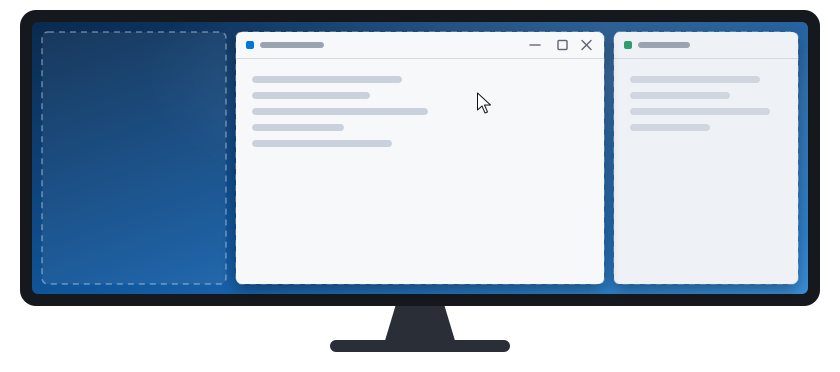

  

<h1 align="center">fz-maximize</h1>

  <b>Maximize into your FancyZones zone, not across your whole ultrawide.</b> 
  <a href="https://fz-maximize.github.io/fz-maximize/">Website &amp; docs</a> ·
  <a href="https://github.com/fz-maximize/fz-maximize/releases/latest">Download</a> ·
  <a href="https://fz-maximize.github.io/fz-maximize/getting-started/">Getting started</a>

fz-maximize makes the Windows **maximize** button, a title-bar double-click, `Win`+`Up` and
dragging to the top edge fill the [PowerToys FancyZones](https://learn.microsoft.com/windows/powertoys/fancyzones)
zone a window is in, instead of the whole monitor.

* **Every way to maximize** goes into the zone the window mostly overlaps (dragging to the
  top edge uses the zone under the cursor). Maximize again to put it back.
* **Full screen when you want it:** hold `Shift` while maximizing, or press
  `Win`+`Shift`+`Up`. The key is configurable.
* **Feels like Windows:** no full-screen flash first, an animation in your Windows
  version's style at Windows' own speed, and zone-maximized windows lock like maximized
  ones (dragging the title bar restores them).
* **Uses your FancyZones layouts** as they are: templates, custom grid and canvas layouts,
  per monitor and per virtual desktop. Layout changes apply at the next maximize.
* **Small and private:** a native app using about 10 MB of memory and no CPU while idle.
  No admin rights, no DLL injection, no network access, no telemetry.

## Install

Requires Windows 10 (1809+) or 11, x64 or ARM64, and PowerToys with FancyZones turned on.

* **Installer:** download `fz-maximize-<version>-x64-setup.exe` (or `-arm64-setup.exe`)
  from the [latest release](https://github.com/fz-maximize/fz-maximize/releases/latest) and
  run it. It installs for your account only, with no admin prompt. It isn't code-signed
  yet, so SmartScreen may warn: choose **More info → Run anyway**.
* **winget:** `winget install fz-maximize` (the listing is under review).
* **Portable:** extract `fz-maximize-<version>-x64-portable.zip` anywhere and run
  `fz-maximize.exe`.

A tray icon appears (a blue tile with three zones). Right-click it for **Settings...**,
**Pause**, and more. Then just maximize windows as usual.

## Using it

| You do | What happens |
|---|---|
| Click maximize, double-click the title bar, or press `Win`+`Up` | The window fills the zone it overlaps most |
| Drag a window to the top edge | It fills the zone under the cursor |
| Maximize a zone-maximized window again | It returns to its previous size |
| Hold `Shift` while maximizing, or press `Win`+`Shift`+`Up` | Normal full-monitor maximize |
| Drag a zone-maximized window's title bar | It restores, like a maximized window |

Monitors without a multi-zone FancyZones layout, excluded monitors and apps, and windows of
apps running as administrator keep the normal maximize. To leave a laptop screen alone, give
it **No layout** in the FancyZones editor, or exclude it in **Settings → Exclusions**.

Full guide: [Using fz-maximize](https://fz-maximize.github.io/fz-maximize/using/) ·
[every setting](https://fz-maximize.github.io/fz-maximize/settings/) ·
[command line](https://fz-maximize.github.io/fz-maximize/command-line/).

## Help

* [Troubleshooting](https://fz-maximize.github.io/fz-maximize/troubleshooting/): what to
  check when maximize doesn't go where you expect.
* [FAQ](https://fz-maximize.github.io/fz-maximize/faq/).
* Found a bug or have an idea? [Open an issue](https://github.com/fz-maximize/fz-maximize/issues).
  Include the output of `fz-maximize --dump` and the log (tray → **Open log folder**).

## Contributing

Contributions are welcome. See [CONTRIBUTING.md](CONTRIBUTING.md) for the workflow and
[docs/DEVELOPMENT.md](docs/DEVELOPMENT.md) for building, testing, the project layout and
how fz-maximize stays in sync with FancyZones. Releases: [docs/RELEASING.md](docs/RELEASING.md).

## License

[MIT](LICENSE). Parts of fz-maximize are ported from
[Microsoft PowerToys](https://github.com/microsoft/PowerToys) (MIT); see
[THIRD_PARTY_NOTICES.md](THIRD_PARTY_NOTICES.md).

fz-maximize is an independent project, not affiliated with or endorsed by Microsoft.
"PowerToys" and "FancyZones" are Microsoft product names, used only to describe
compatibility. [Privacy](https://fz-maximize.github.io/fz-maximize/privacy/).
